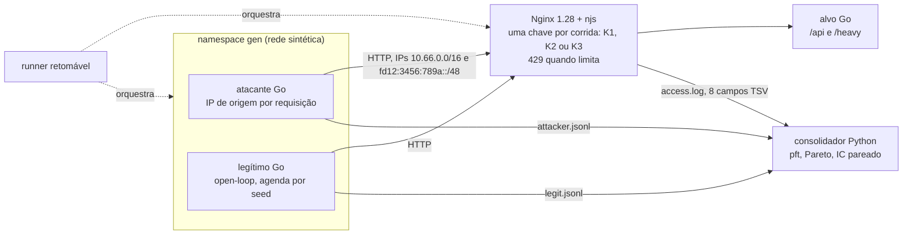

# ratelimit-testbed

Testbed reproduzível para medir o **compromisso entre contenção de HTTP flood e dano a clientes legítimos** de três chaves de rate limiting no Nginx, em cenários onde o endereço IP deixa de identificar o cliente (CGNAT, rotação de IPv6 e proxy residencial).

Projeto da disciplina IMD0703 (UFRN), Unidade III. O artigo propõe a comparação; este repositório é o experimento que a executa.

> **Estado em 25/11/2026:** infraestrutura de medição pronta e testada (10 de 15 tarefas); **nenhuma corrida da matriz foi executada ainda**. Faltam o consolidador do pft, o runner, o spike de validação, a calibração e as saídas para o artigo. Este README não apresenta resultado nenhum.

## A pergunta

Um limitador por IP trata dois clientes legítimos atrás do mesmo IPv4 compartilhado como um só, e um atacante que rotaciona endereços como vários. Quanto cada chave de rate limiting contém o ataque, e quanto dano causa a quem não atacou?

| Chave | O que limita | Hipótese |
|---|---|---|
| **K1** | endereço IP de origem (`$binary_remote_addr`) | penaliza CGNAT; fácil de contornar com muitos IPs |
| **K2** | prefixo de rede: `/24` em IPv4, `/64` em IPv6 | contém rotação dentro do prefixo; agrava o dano a vizinhos do prefixo |
| **K3** | hierárquica: token HMAC por cliente, teto por prefixo (igual ao do K2) e limite por cliente | identidade por cliente reduz o dano colateral sem abrir brecha ao atacante |

A métrica de dano é o **pft** (*probability of failed transactions*), de Mirkovic (2009): `1 − sucesso ÷ transações que teriam sido iniciadas sem ataque`, com o denominador vindo de uma execução sem ataque que usa a mesma agenda de chegadas. Um cliente que espera a resposta não é favorecido por fazer menos transações.

### Cenários e condições

| Cenário | Situação |
|---|---|
| **S1** | CGNAT: clientes legítimos atrás de um IPv4 compartilhado com origens do ataque (SNAT) |
| **S2a** | rotação de endereços IPv6 dentro de um único `/64` |
| **S3** | proxy residencial: ~2.000 IPs em ~250 `/24` |

Cada corrida roda em uma de quatro condições: **C1** sem limitador e sem ataque (dá o denominador do pft), **C2** sem limitador e com ataque (prova que o ataque machuca), **C3** com limitador e sem ataque (o dano colateral mínimo) e **C4** com limitador e com ataque.

A matriz do núcleo tem 16 corridas por seed em S1, 14 em S2a e 12 em S3, com 5 seeds pareadas: **210 corridas**. O resultado é comparativo entre chaves, com curvas de Pareto contenção × pft e intervalo de confiança de 95% da diferença pareada por seed. Não é o número da internet real.

## Arquitetura



O Nginx roda **uma chave por corrida** e é reiniciado a cada corrida (o estado das zonas sobrevive a `reload`). Tudo roda no WSL2, com tráfego benigno gerado pelo grupo contra a API do grupo.

### Estrutura

| Diretório | Conteúdo | Estado |
|---|---|---|
| `target/` | alvo Go: `GET /api` (200, `ok`) e `GET /heavy?ms=N` | pronto |
| `nginx/` | config por chave, `render.sh` (uma chave por corrida), njs do token K3, testes | pronto |
| `gen/attacker/` | gerador de carga com IP de origem por requisição, formas de onda, modos de token | pronto |
| `gen/legit/` | agenda de chegadas por seed e cliente open-loop | pronto |
| `analysis/` | IC pareado (t de Student), significância, fronteira de Pareto | parcial: falta o pft |
| `spike/` | gates G1 (SNAT), G2 (K2), G3 (K3), G4 (agenda) e G5 (origem por requisição); G6 a G10 pendentes | parcial |
| `net/` | namespace `gen` com veth, rotas e SNAT do S1 (`netns-setup.sh`, `netns-teardown.sh`), regra do firewall do Windows e testes | pronto |
| `runner/` | execução retomável da matriz | pendente |
| `env/` | instalação e verificação do ambiente | pronto |
| `CONTRACTS.md` | contratos congelados entre as peças | pronto |

## Contratos

`CONTRACTS.md` é a fonte da verdade da interface entre as peças. Resumo:

- **C-LOG:** `access.log` em TSV com 8 campos: `$msec`, `$remote_addr`, `$server_name`, `$status`, `$request_time`, `$upstream_response_time`, `$limit_req_status`, `$testbed_key`. A chave efetiva sai pela variável `$testbed_key`, não por header HTTP: o prefixo binário do K2 tem bytes `0x00` e `0x0A` que o `net/http` do Go rejeita num header.
- **C-CLI:** flags idênticas nos dois geradores: `--seed --scenario --target --duration --warmup --rate --schedule --out --start-at`. Saída JSONL com `t_start`, `t_end`, `status` e `outcome ∈ {ok, fail_partial, fail_total, fail_refused}`.
- **Tempo zero comum:** `--start-at <unix_ms>` é o instante absoluto em que atacante e legítimo começam. Os `t_start` saem em segundos desde ele.
- **Token K3:** `base64url(cid).base64url(exp).base64url(HMAC-SHA256)`, validade de 300 s. Emissão em `GET /token?cid=<cid>`, uso no header `X-Token`. Sem token, token adulterado ou expirado dá 401 **antes** de qualquer `limit_req`. O segredo vem de `TOKEN_SECRET`, nunca de arquivo versionado.
- **Rede sintética (C-NET):** veth `10.77.255.0/30`, prefixos do atacante `10.66.0.0/16` e `fd12:3456:789a::/48`, prefixos de controle `10.67.0.0/16` e `fd12:3456:789b::/48`, SNAT só no S1.
- **Classificação de desfecho:** o `outcome` do atacante mede acesso concedido × contido; o do legítimo alimenta o pft. Não são comparáveis entre si.

## Como rodar

Requisitos: Ubuntu no WSL2 (ou Linux) com `sudo`, Go 1.22+, Python 3 e Nginx 1.28 com o módulo njs.

```bash
bash env/setup.sh        # pacotes (nftables, conntrack, jq, njs, venv) e verificação
bash env/check_env.sh    # confere binários, njs, venv e criação de netns
bash gate.sh rapido      # testes só do que mudou contra a main
bash gate.sh completo    # tudo: Go, pytest, testes de rede, G1, G5, G4, nginx -t, ambiente
```

O gate rápido roda: varredura de segredos, sintaxe de shell, `go vet` e `go test` de `target/`, `gen/attacker/` e `gen/legit/`, `pytest` (K2, K3, token, agenda, estatística), o gate G4 e `nginx -t` de cada chave renderizada. Os testes com Nginx usam portas fixas (18080, 18081, 18090, 18091, 18099): rode uma suíte por vez.

### Rede sintética

```bash
sudo -n bash net/netns-setup.sh s1      # gen + veth + rotas; s1 acrescenta o SNAT (s2a e s3 ficam sem)
sudo -n bash net/netns-teardown.sh      # remove tudo; código 0 quando nada existe
```

Os gates de rede rodam como usuário comum (eles chamam `sudo -n`) e sobem alvo, Nginx e atacante sozinhos: `spike/g1_snat.sh` (padrão de 2.000 conexões/s por 60 s em S1; `G1_RATE` explícito vence, senão vale o `ATTACK_RATE` de `calibration.env`, e `G1_DURATION` ajusta a janela) e `spike/g5_freebind.sh` (mil origens IPv4 e mil IPv6 distintas no `access.log`). Eles usam as portas 18090 e 18091. `net/fw-windows.ps1` abre a entrada TCP 8081 a 8083 no firewall do Windows; precisa de uma sessão de administrador.

O tráfego de `gen` entra no namespace raiz pela `veth-h`. Quando a cadeia `INPUT` fecha o resto (imagem de nuvem com a cadeia `INPUT` terminada em `REJECT`/`DROP` ou com política `DROP`), o setup insere `iptables -I INPUT 1 -i veth-h -m comment --comment testbed-veth-h -j ACCEPT` — e o equivalente em `ip6tables` sob o mesmo critério —, e o teardown remove só essa regra: é a única alteração que os scripts de `net/` fazem nas tabelas do sistema.

Renderizar a configuração de uma corrida:

```bash
TOKEN_SECRET=... bash nginx/render.sh k3 nginx/sample.params.env /tmp/run
```

## Como sabemos que um teste é legítimo

Três camadas, resumidas em [`docs/guia-validade.md`](docs/guia-validade.md): **A** o ambiente é confiável (gates G1 a G10 antes de qualquer medição), **B** a medição está certa (pft de Mirkovic, legítimo open-loop, reinício do Nginx a cada corrida, seed gravada) e **C** a comparação é justa (quatro condições, teto do K3 idêntico ao do K2, orçamento de token fixo, grupo controle, 5 seeds pareadas). Se uma camada falha, o resultado não vale.

## Decisões e achados que mudaram o projeto

Revisão independente com mutação achou defeitos que o gate verde não via. Os mais relevantes:

- **K2 quebrava o cliente:** o prefixo binário em `X-Key` fazia o `net/http` do Go rejeitar toda resposta, inclusive 429. Contrato do log mudou para `$testbed_key`.
- **K3 aceitava cid terminado em LF:** o `$` do PCRE casa antes de um LF final. Um mutante com `auth_request` no lugar do `if` sobrevivia a toda a suíte e deixava passar 54 de 60 respostas 429 num flood sem token.
- **O tempo zero do legítimo se perdia:** uma atribuição sobrescrevia o `--start-at`, e o atraso nunca chegava a `late_ms`.
- **Falhas silenciosas inflavam a contenção:** erro de bind, de família de endereço, de descritores de arquivo e falha de emissão de token viravam `fail_total`. Agora abortam a corrida.
- **Token no caminho medido:** buscar o token dentro do evento penalizava o K3 por um artefato do gerador. O token é adquirido antes do tempo zero.
- **Testes circulares e flakiness:** oráculos que copiavam a regex que testavam e um teste que lia o log antes de o Nginx gravá-lo (21 falhas em 25 execuções).

Todo defeito vira uma regra de processo: contratos congelados primeiro, uma chave por corrida, laço de 25 execuções para teste com I/O assíncrono, revisão por mutação antes de cada merge e um commit por tarefa.

## Limitações declaradas

- O 429 como falha de transação é **extensão nossa**; Mirkovic (2009) mede por requisitos de QoS.
- Os limiares de 4 s e 60 s vêm de navegação humana em 2007. Uma API tolera menos, por isso há sensibilidade com 1 a 2 s.
- A taxa por IP em S3 é **derivada**: nenhuma fonte a publica.
- O gerador não reproduz TLS/JA4, CGNAT real, custo por GB, IPv6 residencial nem Rapid Reset.
- Testbed isolado: o resultado compara chaves, não estima o número da internet real.
- No WSL2, a faixa de portas efêmeras é estreita (44620 a 48715) e quebra o loopback se for ampliada. Testes com bind por requisição exaurem `TIME_WAIT` se houver outros projetos no mesmo WSL.
- G1 não passa no WSL2, com o limiar intacto (padrão de 2.000 conexões/s por 60 s, mínimo 95%). No WSL2 o gate passa a 100 conexões/s (95,7 medidas em 60 s) e desaba a 200 (15,4 medidas); a 8.000 o atacante morre antes de entregar resultado. Na VM de 2 OCPU passa a 2.000 (1999,6 medidas, CPU do sistema em 59%). A Matriz_Nucleo depende de G1 em PASS: o padrão de 2.000/s é o teto comprovado na VM.

## Uso responsável

Os geradores de carga existem para medir um limitador de taxa em laboratório. A validação de alvo do gerador atacante só aceita loopback, o veth do testbed (`10.77.255.1` e `fd77:255::1`) ou o IP da LAN do próprio laboratório (`HOST_LAN_IP`), e recusa todo o resto. Não aponte nenhum deles contra sistemas que você não controla.

## Desenvolvimento

O código foi construído tarefa a tarefa, cada uma em uma branch própria, com gate local, revisão crítica e de nível 1 independentes (que rodam mutantes em cópia, nunca editam), correção e merge com um commit por tarefa. A spec (requisitos EARS, design e tarefas) e o registro de decisões ficam fora deste repositório.

## Autoria

Samuel Fontes, IMD0703 (UFRN). Referência principal: Mirkovic, J.; Hussain, A.; Fahmy, S.; Reiher, P.; Thomas, R. (2009). *Accurately Measuring Denial of Service in Simulation and Testbed Experiments*. IEEE Transactions on Dependable and Secure Computing, 6(2), 81-95. DOI 10.1109/TDSC.2008.73.
